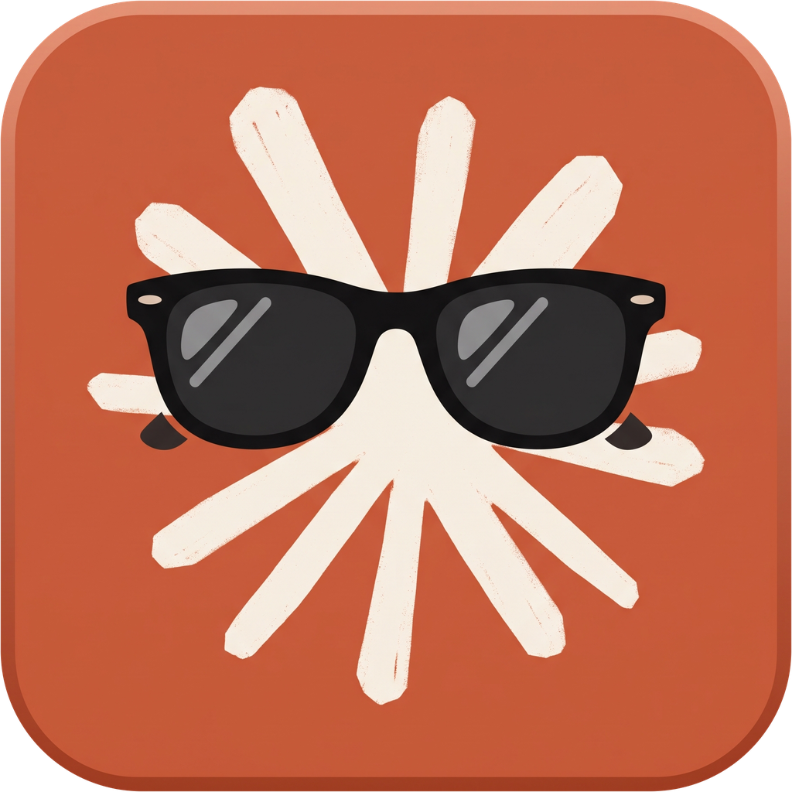
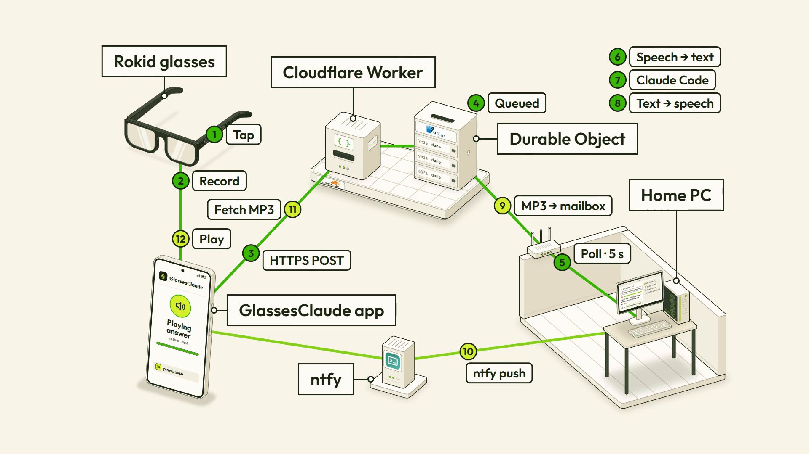

<p align="center">
  
</p>

# GlassCode

Talk to Claude Code through your AI glasses. You speak, your PC writes it down, Claude Code does the
work on your PC, and the answer comes back as a voice in your glasses. At your desk, or from anywhere.
No screen needed.

Everything is free except Claude Code itself, which runs on the Claude plan you already have. Built and
tested on Windows with Rokid AI glasses and an Android phone. The app in this repo is called
**GlassesClaude**.

- **See it in action:** [my Instagram reel](https://www.instagram.com/p/Df2IEjozdMw/)
- **The glasses I use:** [Rokid AI Glasses Style](https://global.rokid.com/products/rokid-ai-glasses-style)
  (no display: mic, speakers, touch pad and camera). Other glasses that pair with your phone like
  Bluetooth headphones may work too, but only these were tested.

## Behind the scenes



*Cover of the explainer video: one request, from a tap on the glasses to the answer playing back in them.*

| # | Step | What happens |
|---|---|---|
| 1 | Tap | The glasses send a Bluetooth play/pause key. The Android app catches it with a MediaSession. |
| 2 | Record | The app records from the glasses' Bluetooth mic (AAC) and stops when you pause for 1.6 s. |
| 3 | HTTPS POST | The recording goes to your own Cloudflare Worker (`POST /api/ask`, phone key). |
| 4 | Queued | The Worker stores the job in a SQLite-backed Durable Object, the "mailbox". |
| 5 | Poll every 5 s | Your home PC asks the mailbox for new jobs (`GET /api/pc/next`). Outbound only, no open ports. |
| 6 | Speech to text | faster-whisper (the "small" model, on the CPU) turns the recording into text on your PC. |
| 7 | Claude Code | `claude -p` runs in your project folder and resumes the same conversation each time. |
| 8 | Text to speech | edge-tts turns Claude's answer into a short MP3. |
| 9 | MP3 to mailbox | The PC uploads the MP3 and the final status to the relay. |
| 10 | ntfy push | The PC sends a "Claude finished" notification through ntfy.sh (the relay sends it if the PC can't). |
| 11 | Fetch MP3 | The phone app downloads the answer. |
| 12 | Play | The answer plays in your glasses. |

You also hear "Got it" right after step 6, so you know your request arrived.

## Get the code

1. Clone it into `C:\GlassesClaude`:
   ```
   git clone https://github.com/arshit09/GlassCode.git C:\GlassesClaude
   ```
   Or click **Code > Download ZIP**, unzip it to `C:\` and rename the folder to `GlassesClaude`.
2. Keep it out of OneDrive: after the install it grows to about 1 GB (mostly the speech model).
3. Follow the steps below, or the full step-by-step guide in [SETUP-GUIDE.md](SETUP-GUIDE.md).
   On your PC, open **START-HERE.html** to see both flows as pictures.

## At your desk

The glasses connect to your PC by Bluetooth. The black GlassesClaude window on the PC then:

1. **Hears**: Whisper turns your voice into text, right on your PC.
2. **Does**: Claude Code runs that text in your project folder, as if you had typed it.
3. **Speaks**: the answer is turned into a short voice and sent back to your glasses.

Set it up:

1. **Double-click `1 - Install`.** It installs everything into this folder, downloads the speech
   model (about 0.5 GB, once) and checks that Claude Code is installed and signed in. Safe to run again.
   If Windows warns about running a downloaded file, choose More info, then Run anyway.
2. **Pair the glasses with this PC.** Windows Settings > Bluetooth & devices > Add device, with the
   glasses in pairing mode (see the Rokid manual). They show up as a headset with a microphone.
3. **Double-click `2 - Start`.** A black window opens. Keep it open.
4. **Press Ctrl + Alt + Space** (or tap the glasses), talk, then pause. You hear a beep, "Got it: ...",
   then Claude's answer.

No glasses yet? Open the talk-page link shown in the black window, click the button and talk into any
microphone.

## When you're out

The glasses connect to your phone as usual; your PC stays at home and does the work.

```
glasses --Bluetooth--> phone app --internet--> your Cloudflare relay (free) <--asks every 5 s-- your PC
glasses <--spoken----- phone app <--answer---- relay <--------------answer + voice------------- your PC
                       phone     <--notification "Claude finished" (ntfy, free)-- relay
```

Your PC never opens a door to the internet: it only asks the relay every few seconds.

Set it up once:

1. **Double-click `3 - Set up away mode (optional)`.** It installs Node.js if needed, opens your
   browser once so you can sign in to Cloudflare (free account, no credit card), puts your private relay
   online, and opens a page with a QR code.
2. **Scan the QR code with your phone.** The GlassesClaude app opens with your private key. Add it to
   your home screen from the browser menu.
3. **Turn on notifications.** Install the free **ntfy** app and subscribe to the topic shown on the QR
   page. In the GlassesClaude app, tap Settings, then Send a test.
4. **Reopen `2 - Start` and leave the PC on.** GlassesClaude keeps the PC awake while it runs. To start
   it automatically, run `tools\Start GlassesClaude with Windows (optional)`.

Then, when you're out: open the app, tap the button and say, for example, "in my portfolio project, fix
the header spacing" or "create a new folder called pizza-site with a simple website". You hear "Got it"
right away; when Claude is done you get a notification and the app plays the answer in your glasses.

Hands-free:
- **Android:** in the app's Settings turn on "Start listening as soon as the app opens", then say
  "Hey Google, open GlassesClaude".
- **iPhone:** make a Shortcut "Ask my PC": Dictate Text, Get Contents of URL (POST to your relay's
  `/api/ask?format=text`, header `X-Key` = your key from the app's Settings, JSON field `text` = the
  dictated text), Speak Text. Then "Hey Siri, ask my PC". A second shortcut that GETs `/api/latest.txt`
  with the same header and speaks it answers "what did Claude say?".

What it costs: nothing extra. Cloudflare Workers' free plan allows 100,000 requests a day and your PC
uses about 17,000 (one check every 5 seconds). ntfy.sh is free without an account. Whisper and the
voice are free. Claude Code runs on your existing plan, on your PC.

## Phone in your pocket: tap your glasses to talk (Android)

The web app needs the phone in your hand to start. The small Android app in the `android` folder
doesn't: tap your glasses once, talk, and the answer plays in your glasses while the phone stays
locked in your pocket. On your phone, download
[GlassesClaude.apk](https://github.com/arshit09/GlassCode/releases/latest/download/GlassesClaude.apk)
from the [latest release](https://github.com/arshit09/GlassCode/releases/latest) and install it (or build it
yourself with Android Studio), then paste your phone link into it (web app Settings > Copy phone link).
Step-by-step: `android\README.md`.

## Record now, run later

Record a voice memo with the glasses. Put the file in the `inbox` folder (share it from the Hi Rokid app
to OneDrive or Google Drive, or use the ADB copy tool in `tools`). A memo that starts with "Claude, ..."
is run as a command; any other memo is saved as a note. Results appear in `inbox\done`. To watch a cloud
folder instead, set `folder` under `[voice_memos]` in settings.toml.

## Things you can say

Anything you would type into Claude Code. Claude remembers the conversation, so "now commit it" works.

Said on their own, these words are handled instantly:

| Say | What happens |
|---|---|
| stop | cancels the task that is running |
| new chat | starts a fresh conversation |
| repeat | plays the last answer again |
| status | tells you what Claude is doing |
| which project | tells you which folder Claude works in |
| switch to portfolio | moves to a project you named in settings.toml |

## Choose the folder Claude works in

Claude starts in the practice folder `workspace`. To use your real projects, open `settings.toml` with
Notepad, write the folder in single quotes, save, and reopen `2 - Start`. Pointing it at the folder that
holds all your projects lets you say "in my portfolio project, ..." or "create a new folder ...":

```toml
project_folder = 'C:\Users\you\source\repos'

[projects]
portfolio = 'C:\Users\you\source\repos\my-portfolio'
```

## Good to know

- Claude runs in **auto** mode: it does the work and a safety checker blocks risky actions. Nobody can
  click "Allow" while you're only talking, so steps that need approval are skipped and Claude tells you.
  You can choose a stricter `permission_mode` in settings.toml.
- Spoken answers are short. The full answers are in `logs\history.md` and in the phone app.
- Your voice is turned into text on your PC. The text goes to Claude Code. The answer text goes to
  Microsoft's free online voice to be read aloud; without internet the Windows voice is used.
- When you're out, requests and answers wait in your own Cloudflare relay and are deleted after 3 days.
  Notifications include the short answer; set `answer_in_notification = false` under `[away]` in
  settings.toml to keep answers out of them.
- If your PC is off, a request waits up to 2 hours; after that it isn't run and you get a notification.
- The talk-page link and the phone link contain private keys. Don't share them. Run the away-mode setup
  with `--new-keys` to replace the phone key.
- Close the black window to stop everything.

## If something doesn't work

- **The microphone isn't your glasses:** make sure they're paired and connected in Windows Bluetooth
  settings, then reopen `2 - Start`. If it still picks another microphone, the black window lists the
  microphones it can see; put part of the glasses' name in settings.toml as `microphone` and `speaker`.
- **Claude Code: NOT FOUND:** in PowerShell run `irm https://claude.ai/install.ps1 | iex`, then type
  `claude` once to sign in, and reopen `2 - Start`.
- **The phone app says "PC offline":** check that `2 - Start` is running and the PC is on and online.
- **No notification arrives:** check the ntfy topic matches the QR page exactly, then use Send a test.
- **Away-mode setup asks for a workers.dev address:** in the Cloudflare dashboard open Workers & Pages,
  pick a free workers.dev subdomain, then run the setup again.
- **The keys do nothing:** another program may use them, or an administrator window is in front. Pick
  other keys in settings.toml, for example `hotkey = "f8"`.
- **The install stops with an error:** check the internet connection and run `1 - Install` again.

## What's in this folder

| File or folder | What it is |
|---|---|
| 1 - Install | Sets everything up on this PC. Safe to run again. |
| 2 - Start | Starts GlassesClaude. Keep its window open. |
| 3 - Set up away mode (optional) | Puts your free relay on Cloudflare and makes the phone link. |
| settings.toml | Your settings: project folder, keys, voice, safety mode, away mode. |
| workspace | Claude's practice folder until you choose a project. |
| inbox | Drop voice memos here. Results go to inbox\done. |
| logs\history.md | Everything you said and every answer (created on first use). |
| relay | The free cloud relay and the phone app (uploaded by the away-mode setup). |
| android | The Android app: tap your glasses to talk with the phone in your pocket. |
| tools | Start with Windows, and optional ADB helpers for glasses that allow a USB connection. |
| app | The program itself (Python). |
| docs | Images for this README. |
